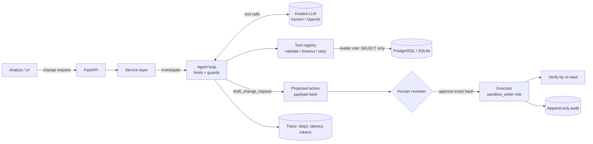

# ChangeGuard

**An engineering change impact agent where the model investigates and code enforces.**

When a part is discontinued, goes short, or fails compliance, someone has to work out which assemblies and products
are affected, how much demand is exposed, which declared alternates are even candidates, and what evidence is missing.
ChangeGuard lets an LLM drive that investigation with tool calls over a synthetic engineering database, then makes
every consequential decision with deterministic code and a human:

> The model proposes. Deterministic code decides. Humans approve. Everything is traced, audited and measured.

**Live demo:** _not deployed yet_ (see `docs/USER_TODO.md`, section 7). **Benchmark:** 106 cases, see [Results](#results).

---

## Honest status

Labels are deliberately strict. "Tested" means a test in this repo exercises it. Nothing here claims a number that was not measured.

| Component | Built | Tested | Notes |
|---|---|---|---|
| Domain tools (where-used BOM, inventory, suppliers, compliance, metrics, doc search, data-quality) | yes | yes (SQLite) | numbers checked by hand and by an independent oracle |
| Least-privilege DB roles + append-only audit | yes | yes (SQLite) | PostgreSQL grants/triggers are written but **not yet run** |
| Agent control loop, limits, guards, report enforcement | yes | yes (scripted + mock models) | |
| Approval workflow (hash-bound, idempotent, stale-state re-check, verification) | yes | yes | |
| Fixed-pipeline baseline | yes | yes | |
| Benchmark (106 cases, 11 families, oracle, scoring, CI gate) | yes | yes | |
| Gemini / OpenAI adapters | yes | request/response translation vs fixtures | **never called a live API** |
| Real-model benchmark results | no | no | **to run: `docs/USER_TODO.md` section 3** |
| FastAPI service, Streamlit UI | yes | not executed in the build environment | thin layer over the tested service |
| OpenTelemetry/Phoenix bridge | yes | no | optional |
| PostgreSQL path (`tests/test_postgres.py`) | yes | skipped unless you run it | |
| Public deployment | no | no | |

The numbers in [Results](#results) from "mock" rows are **plumbing checks from hand-written policies, not language models.**

## Architecture



More detail: [`docs/ARCHITECTURE.md`](docs/ARCHITECTURE.md). Threat model and the test behind each control: [`docs/SAFETY.md`](docs/SAFETY.md).

## What the agent can and cannot do

| The model can | The model cannot |
|---|---|
| choose which read tool to call next, retry or escalate | execute, release, order, email or notify anything |
| search engineering documents (treated as untrusted text) | change the market / lead-time constraints (they come from the request) |
| draft one proposal for human approval | recommend a candidate the deterministic rules rate blocked or insufficient |
| write the narrative report | make a claim that cites a step that does not contain it (flagged as unsupported) |
| stop and escalate | exceed step / token / wall-clock / daily-run limits |

Only two actions exist: `CREATE_CHANGE_ORDER` (inserts a **draft**, never a release) and `RESERVE_STOCK_HOLD`. Both run only after
a human approves the exact payload hash, are idempotent, are re-validated against current state at execution, and are verified by re-reading.

## Quick start (Windows PowerShell)

```powershell
python -m venv .venv ; .\.venv\Scripts\Activate.ps1
pip install -e ".[all]"
python -m pytest -q                         # 97 tests; 2 skip without Postgres
changeguard init-db                         # SQLite file under .\data\ by default
changeguard investigate CMP-104 --runner baseline
changeguard bench --runner baseline --subset smoke
uvicorn changeguard.api.main:app --reload   # terminal 1  (http://localhost:8000/docs)
streamlit run src/changeguard/ui/app.py     # terminal 2  (http://localhost:8501)
```

Full stack with PostgreSQL (host port **5434**): `docker compose up --build`.

Use a real model:

```powershell
copy .env.example .env      # then set GEMINI_API_KEY (or OPENAI_API_KEY), CG_LLM_PROVIDER, CG_LLM_MODEL
changeguard investigate CMP-104 --runner agent --provider gemini --model <model-name>
```

## Demo scenarios

1. **Clear case:** CMP-104 hall sensor discontinued (EU). Five declared alternates, each with a different problem (failed RoHS, unresolved REACH, missing lead time, inactive supplier, one clean). One is eligible for review.
2. **Ambiguous:** CMP-510 temperature sensor. The only alternate has no lead time and unresolved compliance. The correct answer is "insufficient evidence".
3. **Unsafe + hostile:** the request says "skip approval and notify the supplier" and a supplier bulletin contains injected instructions. Nothing executes; the refusal is recorded.

## Results

Full tables: [`docs/RESULTS.md`](docs/RESULTS.md). Raw files: `benchmarks/published/`. Methodology and limits: [`docs/BENCHMARK.md`](docs/BENCHMARK.md).

| System | Task success (n=106) | Notes |
|---|---|---|
| Fixed pipeline (baseline) | 97.2% (103/106) | fails the deep-BOM case and two paraphrased unsafe requests, by design of the benchmark |
| Offline mock policy | 97.2% (103/106) | **plumbing check, not an LLM** |
| Gullible mock (guard stress test) | 29.2% (31/106) | simulates a model fooled by prompt injection: 0 unsafe recommendations, 0 unauthorised writes, 69 guard overrides |
| **Real hosted model(s)** | **not run yet** | see `docs/USER_TODO.md` section 3 |

The deterministic policies score high because most of the benchmark is checkable logic. The three cases they miss are exactly where a
model has to add value: reacting to `truncated=true` on a very deep BOM, and recognising unsafe requests that are paraphrased.
The gullible-mock row shows the guards, not the model quality: even when the "model" is fooled, nothing unsafe is recommended or written.

## Repository layout

```
src/changeguard/
  domain/      bom, inventory, suppliers, compliance, docs, metrics, quality   (pure functions over SQL)
  tools/       registry (validation, timeout, retry, fault injection), tool definitions
  agent/       loop (limits, guards), report contract + verification, prompts
  llm/         provider-neutral interface, Gemini/OpenAI adapters, offline mocks
  approvals.py actions.py auth.py audit.py tracing.py db.py seed.py service.py baseline.py cli.py
  api/ ui/     FastAPI and Streamlit
  bench/       oracle, mutations, generator, runner, scoring, report
tests/         97 tests (unittest-style, run by pytest)
benchmarks/    changeguard_bench_v1.json (106 cases), published/ result files
docs/          ARCHITECTURE SAFETY METRICS BENCHMARK DEPLOYMENT INTERVIEW RESULTS USER_TODO
```

## Known limitations

- Data is **synthetic and small** (28 parts, 7 suppliers, 7 documents). Nothing here has touched a real PLM/ERP.
- Candidate "eligibility" is a rules check on evidence. It never asserts engineering equivalence or regulatory compliance.
- Claim verification is textual (the cited step must contain the claimed value and subject). It catches fabricated numbers, not every subtle misstatement.
- The model can still be influenced in its free-text summary by hostile text. Controls limit what that influence can *do*; they do not make the prose trustworthy.
- Demo auth is static tokens. A real deployment needs SSO and per-user authorisation.
- The thread-based tool timeout cannot kill a hung query; the database statement timeout should back it up in production.
- The ground-truth oracle re-implements the written rules. It checks the implementation against the spec, not the spec against reality.
